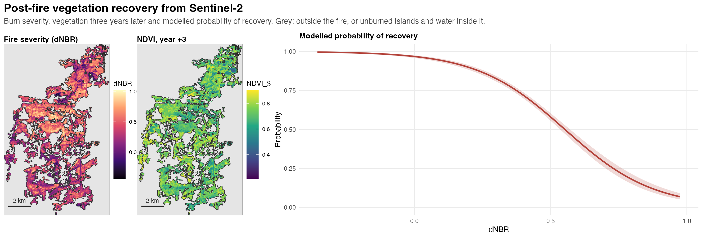
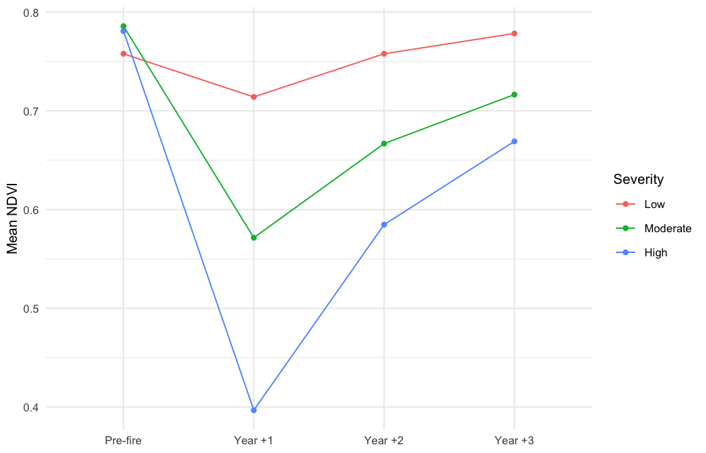
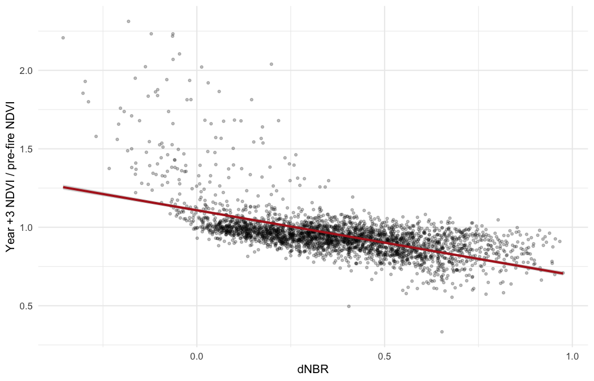

# Post-fire vegetation recovery from Sentinel-2




A basic question after a wildfire is where vegetation comes back and where it does not. This repository answers it for one fire, with open satellite data and R only: it measures how severely each 20 m pixel burned (dNBR), how much of its pre-fire greenness (NDVI) it has recovered three years later, and tests whether severity explains the difference. At this stage NDVI reflects mostly herbaceous and shrub cover, so this is recovery of greenness, not of tree regeneration (see Limitations).

It also covers a common pitfall of spatial data. Neighbouring pixels are not independent, so ordinary regression overstates certainty. The report quantifies this and compares three ways of handling it (Moran's I, a mixed model with a random cell effect, and a spatially thinned sample).

**Use it as a template:** to repeat the analysis on another fire, change the perimeter file and the fire year in [`01_build_dataset.R`](01_build_dataset.R) and re-run. No account or API key is needed.

**Read the full report:** [`analysis.md`](analysis.md)

## Questions and methods

| Question | Methods |
|---|---|
| Does recovery differ among severity classes? | ANOVA with Tukey comparisons, Kruskal-Wallis check |
| Which variables best explain year +3 NDVI? | Linear regression, residual diagnostics, AIC model comparison |
| What is the probability that a pixel has recovered? | Logistic regression, odds ratios, AUC |
| What changes when spatial dependence is considered? | Moran's I, mixed model with a random cell effect, spatially thinned subsample |
| Do pixels form homogeneous zones? | PCA, Ward hierarchical clustering, map of the groups |

## Key results

Case study: a 4,674 ha fire (2023) near Lebel-sur-Quévillon, Québec, analysed on 2,984 randomly sampled 20 m pixels.

- **Severity matters.** The recovery index (year +3 NDVI / pre-fire NDVI) falls from 1.06 in low-severity pixels to 0.91 (moderate) and 0.86 (high). Spearman correlation with dNBR: rho = -0.63.
- **Recovery odds drop sharply with severity.** Each 0.1 increase in dNBR multiplies the odds of recovery (year +3 NDVI at least 90% of pre-fire) by 0.54 (95% CI 0.51 to 0.57). 68.9% of pixels have recovered; in-sample AUC is 0.81.
- **Spatial dependence is strong.** Moran's I of the linear model residuals is 0.40. A random cell effect (500 m; intraclass correlation 0.34) brings it down to 0.07.
- **The severity effect holds, others do not.** The dNBR coefficient is -0.232 (linear), -0.243 (mixed) and -0.219 (spatially thinned). The elevation coefficient changes sign between the linear and the mixed model, so it should not be interpreted.





These are associations from a single fire, not causal effects. Full methods, diagnostics and limitations are in [`analysis.md`](analysis.md).

## How it works

1. **Data acquisition in R** ([`R/acquisition.R`](R/acquisition.R), run by
   [`01_build_dataset.R`](01_build_dataset.R)). Sentinel-2 level 2A scenes are found
   through the public STAC catalogue (Earth Search) with `rstac` and read directly as
   cloud-optimized GeoTIFFs with `terra`, so only the pixels covering the fire are
   downloaded. Clouds and shadows are masked with the SCL band, the +1000 offset of
   post-2022 processing baselines is removed, and a median composite is built for each
   summer (15 June to 15 September). NBR and NDVI are computed for the summer before the
   fire, then NDVI for years +1, +2 and +3. dNBR is pre-fire NBR minus year +1 NBR.
   Elevation and slope come from the Copernicus 30 m DEM. A random sample of pixels is
   written as CSV and the full raster as GeoTIFF.
2. **Analysis in R** ([`analysis.Rmd`](analysis.Rmd)). Maps with `ggplot2`, then the
   statistical chain above.

```
01_build_dataset.R                  Step 1: builds the dataset (settings + run)
R/acquisition.R                     STAC search, cloud masking, composites, indices, sampling
R/functions.R                       Helper functions (data loading, severity classes, maps, Moran's I)
R/make_hero_figure.R                Builds the overview figure shown above
analysis.Rmd                        Reproducible report
tests/                              Offline tests with synthetic data (never to publish)
data/                               Fire perimeter and generated dataset
```

## Reproduce the analysis

1. Install the R packages:

   ```r
   install.packages(c("rstac", "terra", "sf", "dplyr", "tidyr", "readr", "ggplot2",
                      "patchwork", "broom", "knitr", "rmarkdown", "spdep", "scales", "lme4"))
   ```

2. Save a fire perimeter in `data/` (for example `data/fire_perimeter.gpkg`, from the
   public fire perimeter databases of Natural Resources Canada or SOPFEU).
3. Open `01_build_dataset.R`, set `perimeter_path` and `fire_year` (the summer of year +3
   must be over) and run it. The first run reads several dozen scenes per summer and can
   take a while; each yearly composite is cached in `data/composites/`.
4. Generate the report and the overview figure:

   ```r
   rmarkdown::render("analysis.Rmd")
   source("R/make_hero_figure.R")
   ```

## Testing the code without real data

```r
source("tests/test_acquisition.R")   # compositing and dataset logic on fake scenes
source("tests/simulate_test_data.R")
rmarkdown::render("analysis.Rmd", params = list(data_dir = "tests/synthetic_data"))
```

These data are synthetic and only check that the code runs. Results obtained this way
have no scientific value.

## Related work

This repository is the within-fire companion of
[`lebel-fire-vegetation-recovery`](https://github.com/geoforestdata/lebel-fire-vegetation-recovery),
which compares 78 fires (1985-2023, Landsat and ERA5-Land, Python) at the fire level.
That analysis lists within-fire heterogeneity as a limitation. Here a single fire inside
the same study area (2023, about 25 km from Lebel-sur-Quévillon) is analysed at the pixel
level with Sentinel-2, in R: what explains differences in recovery within one fire, and
how much does ignoring spatial dependence change the answer. The fire is too recent for
the cohort comparison to include its three-year recovery.

## Limitations

NDVI measures greenness, not forest. Three years after a fire the signal comes mostly from herbaceous and shrub cover, including ericaceous understory, because tree seedlings are still too small to dominate a pixel. "Recovery" here means recovery of greenness, not of tree regeneration, and it should be checked against field-based regeneration data. NDVI also saturates under dense canopy and says nothing about species or stand structure. The
dNBR class thresholds are generic and not calibrated for the boreal forest. The recovery
threshold of the logistic regression (90% of pre-fire NDVI) is an arbitrary choice that
can be changed in the parameters of `analysis.Rmd`. The sampled points are spatially
autocorrelated, which the report evaluates. The analysis covers a single fire and
describes associations, not causes. The limitations are detailed at the end of
`analysis.Rmd`.

## How to cite this repository

Vega Escobar, A. (2026). Post-fire vegetation recovery from Sentinel-2: spatial statistics in R [GitHub repository]. GitHub. https://github.com/geoforestdata/post-fire-recovery-sentinel2

```bibtex
@misc{vegaescobar2026postfire,
  author       = {Vega Escobar, Alejandro},
  title        = {Post-fire vegetation recovery from Sentinel-2: spatial statistics in R},
  year         = {2026},
  publisher    = {GitHub},
  howpublished = {\url{https://github.com/geoforestdata/post-fire-recovery-sentinel2}}
}
```

## Data sources

- Sentinel-2 Level-2A surface reflectance, ESA / Copernicus, accessed through the Earth Search STAC catalogue.
- Copernicus DEM GLO-30, ESA / Copernicus.
- Fire perimeter: Canadian National Fire Database, Natural Resources Canada, Canadian Forest Service.

## Author

Alejandro Vega Escobar
