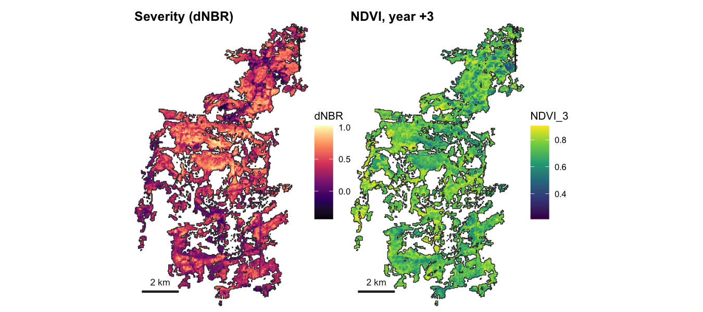
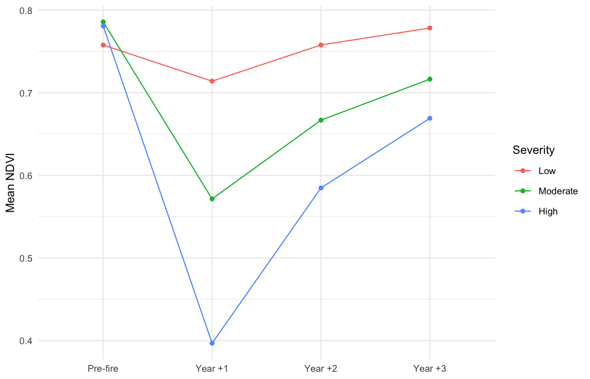
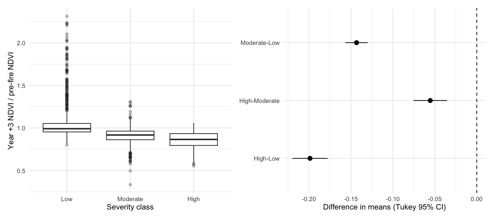
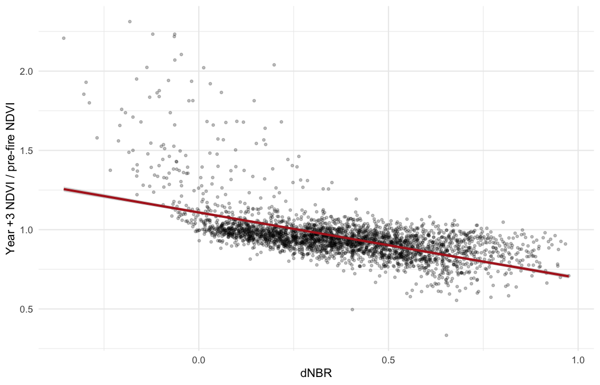
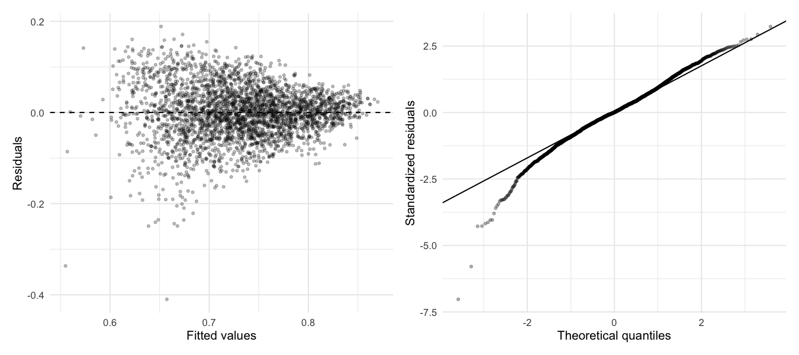
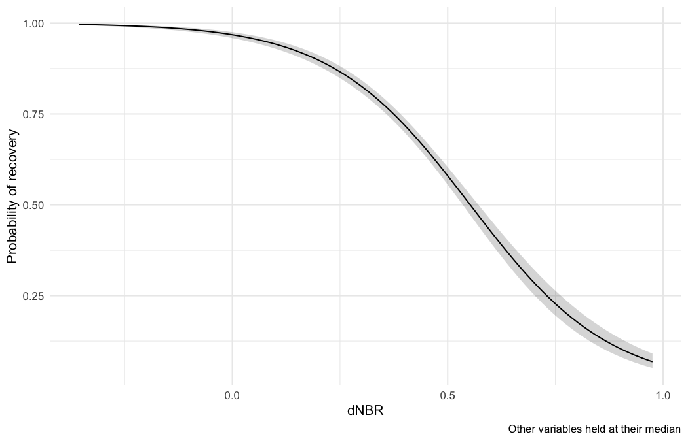
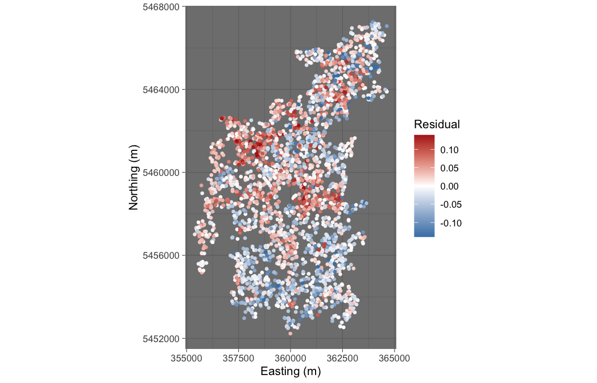
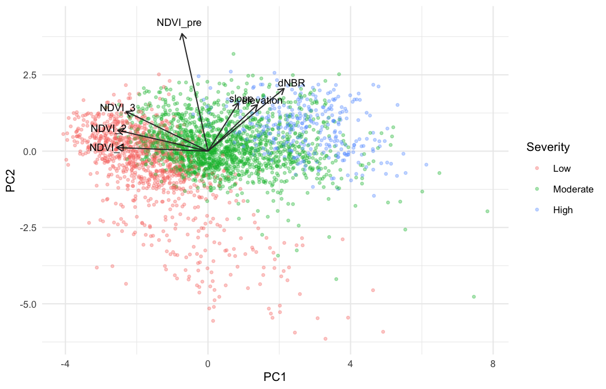
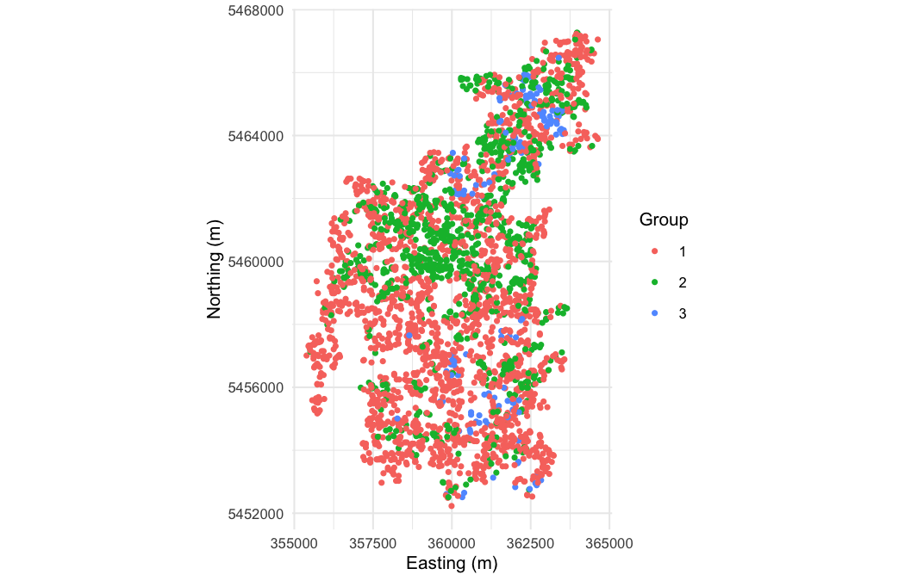

Post-fire vegetation recovery in the boreal forest: statistical methods
on Sentinel-2 data
================
Alejandro Vega Escobar
2026-11-17

- [Objective](#objective)
- [1. Import and cleaning](#1-import-and-cleaning)
- [2. Maps](#2-maps)
- [3. Descriptive statistics by severity
  class](#3-descriptive-statistics-by-severity-class)
- [4. Does recovery differ among severity
  classes?](#4-does-recovery-differ-among-severity-classes)
- [5. Correlation between severity and
  recovery](#5-correlation-between-severity-and-recovery)
- [6. Linear regression](#6-linear-regression)
- [7. Which set of variables best explains year +3
  NDVI?](#7-which-set-of-variables-best-explains-year-3-ndvi)
- [8. Probability that a pixel has
  recovered](#8-probability-that-a-pixel-has-recovered)
- [9. Spatial dependence](#9-spatial-dependence)
  - [Mixed model: random intercept by 500 m
    cell](#mixed-model-random-intercept-by-500-m-cell)
  - [Sensitivity: spatially thinned
    subsample](#sensitivity-spatially-thinned-subsample)
- [10. Multivariate structure and homogeneous
  zones](#10-multivariate-structure-and-homogeneous-zones)
- [11. Limitations](#11-limitations)
- [Reproducibility](#reproducibility)

## Objective

Apply a chain of statistical methods to a spatial problem: does fire
severity (dNBR) explain vegetation recovery (NDVI) three years later,
and what changes when the spatial dependence between neighbouring pixels
is taken into account? The indices are computed in R
(`01_build_dataset.R`). The analysis is done in R.

Questions addressed:

1.  Does recovery differ among severity classes?
2.  Which set of variables best explains year +3 NDVI?
3.  What is the probability that a pixel has recovered, given severity
    and terrain?
4.  What changes when spatial dependence is taken into account?
5.  Do the pixels form homogeneous zones that can be mapped?

## 1. Import and cleaning

`load_data()` (in `R/functions.R`) reads the exports, projects the
points to the raster CRS, drops missing values, removes pixels with low
pre-fire NDVI (water and non-vegetated surfaces) and computes the
severity class, the recovery index (year +3 NDVI / pre-fire NDVI) and a
binary recovered flag.

``` r
dat <- load_data(params$data_dir, params$min_ndvi_pre, params$recovery_threshold)
pts <- dat$pts
r <- dat$raster

tibble(
  step = c("Exported points", "Retained points (no missing values, pre-fire NDVI >= threshold)"),
  n = c(dat$n_raw, nrow(pts))
) |> kable()
```

| step                                                             |    n |
|:-----------------------------------------------------------------|-----:|
| Exported points                                                  | 3000 |
| Retained points (no missing values, pre-fire NDVI \>= threshold) | 2984 |

## 2. Maps

``` r
plot_raster_layer(r, "dNBR", "Severity (dNBR)", option = "magma") +
  plot_raster_layer(r, "NDVI_3", "NDVI, year +3", option = "viridis")
```

<!-- -->

## 3. Descriptive statistics by severity class

``` r
pts |>
  group_by(severity) |>
  summarise(
    n = n(),
    dNBR_mean = mean(dNBR),
    RI3_mean = mean(RI3),
    RI3_sd = sd(RI3),
    RI3_median = median(RI3),
    .groups = "drop"
  ) |>
  kable(digits = 3)
```

| severity |    n | dNBR_mean | RI3_mean | RI3_sd | RI3_median |
|:---------|-----:|----------:|---------:|-------:|-----------:|
| Low      | 1001 |     0.126 |    1.055 |  0.211 |      0.992 |
| Moderate | 1654 |     0.447 |    0.912 |  0.085 |      0.918 |
| High     |  329 |     0.756 |    0.857 |  0.097 |      0.865 |

``` r
pts |>
  select(severity, NDVI_pre, NDVI_1, NDVI_2, NDVI_3) |>
  pivot_longer(-severity, names_to = "period", values_to = "ndvi") |>
  group_by(severity, period) |>
  summarise(ndvi = mean(ndvi), .groups = "drop") |>
  mutate(period = factor(period,
                         levels = c("NDVI_pre", "NDVI_1", "NDVI_2", "NDVI_3"),
                         labels = c("Pre-fire", "Year +1", "Year +2", "Year +3"))) |>
  ggplot(aes(x = period, y = ndvi, colour = severity, group = severity)) +
  geom_line() + geom_point() +
  labs(x = NULL, y = "Mean NDVI", colour = "Severity") +
  theme_minimal(base_size = 10)
```

<!-- -->

## 4. Does recovery differ among severity classes?

One-way analysis of variance of the recovery index by severity class,
followed by Tukey’s multiple comparisons. The Kruskal-Wallis test serves
as a check if the ANOVA assumptions are doubtful.

``` r
aov_fit <- aov(RI3 ~ severity, data = pts)
summary(aov_fit)
```

    ##               Df Sum Sq Mean Sq F value Pr(>F)    
    ## severity       2  16.32    8.16   409.1 <2e-16 ***
    ## Residuals   2981  59.45    0.02                   
    ## ---
    ## Signif. codes:  0 '***' 0.001 '**' 0.01 '*' 0.05 '.' 0.1 ' ' 1

``` r
tuk <- tidy(TukeyHSD(aov_fit))
tuk |> select(contrast, estimate, conf.low, conf.high, adj.p.value) |> kable(digits = 4)
```

| contrast      | estimate | conf.low | conf.high | adj.p.value |
|:--------------|---------:|---------:|----------:|------------:|
| Moderate-Low  |  -0.1433 |  -0.1566 |   -0.1301 |           0 |
| High-Low      |  -0.1988 |  -0.2198 |   -0.1777 |           0 |
| High-Moderate |  -0.0555 |  -0.0754 |   -0.0355 |           0 |

``` r
bartlett.test(RI3 ~ severity, data = pts)
```

    ## 
    ##  Bartlett test of homogeneity of variances
    ## 
    ## data:  RI3 by severity
    ## Bartlett's K-squared = 1131.9, df = 2, p-value < 2.2e-16

``` r
kruskal.test(RI3 ~ severity, data = pts)
```

    ## 
    ##  Kruskal-Wallis rank sum test
    ## 
    ## data:  RI3 by severity
    ## Kruskal-Wallis chi-squared = 863.93, df = 2, p-value < 2.2e-16

``` r
p_box <- ggplot(pts, aes(x = severity, y = RI3)) +
  geom_boxplot(outlier.alpha = 0.3) +
  labs(x = "Severity class", y = "Year +3 NDVI / pre-fire NDVI") +
  theme_minimal(base_size = 10)

p_tuk <- ggplot(tuk, aes(x = contrast, y = estimate, ymin = conf.low, ymax = conf.high)) +
  geom_pointrange() +
  geom_hline(yintercept = 0, linetype = 2) +
  coord_flip() +
  labs(x = NULL, y = "Difference in means (Tukey 95% CI)") +
  theme_minimal(base_size = 10)

p_box + p_tuk
```

<!-- -->

With a large number of pixels, a very small difference can be
statistically significant without being important. The size of the
differences matters, not only the p-values.

## 5. Correlation between severity and recovery

``` r
ct <- cor.test(pts$dNBR, pts$RI3, method = "spearman", exact = FALSE)

ggplot(pts, aes(x = dNBR, y = RI3)) +
  geom_point(alpha = 0.25, size = 0.8) +
  geom_smooth(method = "lm", se = TRUE, colour = "firebrick") +
  labs(x = "dNBR", y = "Year +3 NDVI / pre-fire NDVI") +
  theme_minimal(base_size = 10)
```

<!-- -->

``` r
cat(sprintf(
  "Spearman correlation between dNBR and the recovery index: rho = %.2f (%s, n = %d).\n",
  unname(ct$estimate), format_p(ct$p.value), nrow(pts)
))
```

Spearman correlation between dNBR and the recovery index: rho = -0.63 (p
\< 0.001, n = 2984).

## 6. Linear regression

The response is year +3 NDVI. Pre-fire NDVI is a covariate, which
amounts to comparing pixels with similar initial productivity. The
topographic covariates control for the effect of terrain.

``` r
lm_fit <- lm(NDVI_3 ~ dNBR + NDVI_pre + elevation + slope, data = pts)
tidy(lm_fit, conf.int = TRUE) |> kable(digits = 4)
```

| term        | estimate | std.error | statistic | p.value | conf.low | conf.high |
|:------------|---------:|----------:|----------:|--------:|---------:|----------:|
| (Intercept) |   0.3562 |    0.0218 |   16.3251 |  0.0000 |   0.3135 |    0.3990 |
| dNBR        |  -0.2318 |    0.0054 |  -42.9311 |  0.0000 |  -0.2424 |   -0.2213 |
| NDVI_pre    |   0.4907 |    0.0143 |   34.3632 |  0.0000 |   0.4627 |    0.5187 |
| elevation   |   0.0003 |    0.0001 |    4.6334 |  0.0000 |   0.0002 |    0.0004 |
| slope       |  -0.0005 |    0.0003 |   -1.7664 |  0.0774 |  -0.0011 |    0.0001 |

``` r
glance(lm_fit) |> select(r.squared, adj.r.squared, sigma, nobs) |> kable(digits = 3)
```

| r.squared | adj.r.squared | sigma | nobs |
|----------:|--------------:|------:|-----:|
|      0.48 |         0.479 | 0.058 | 2984 |

``` r
aug <- augment(lm_fit)

p1 <- ggplot(aug, aes(.fitted, .resid)) +
  geom_point(alpha = 0.25, size = 0.8) +
  geom_hline(yintercept = 0, linetype = 2) +
  labs(x = "Fitted values", y = "Residuals") +
  theme_minimal(base_size = 10)

p2 <- ggplot(aug, aes(sample = .std.resid)) +
  stat_qq(alpha = 0.3, size = 0.8) + stat_qq_line() +
  labs(x = "Theoretical quantiles", y = "Standardized residuals") +
  theme_minimal(base_size = 10)

p1 + p2
```

<!-- -->

## 7. Which set of variables best explains year +3 NDVI?

Candidate models are compared with Akaike’s information criterion (AIC).
An AIC difference (delta) below 2 indicates roughly equivalent models.

``` r
candidates <- list(
  "M0: pre-fire NDVI"                = lm(NDVI_3 ~ NDVI_pre, data = pts),
  "M1: M0 + dNBR"                    = lm(NDVI_3 ~ NDVI_pre + dNBR, data = pts),
  "M2: M1 + elevation + slope"       = lm_fit,
  "M3: M2 + dNBR x slope interaction" = lm(NDVI_3 ~ NDVI_pre + dNBR * slope + elevation, data = pts)
)

tibble(
  model = names(candidates),
  parameters = sapply(candidates, function(m) length(coef(m)) + 1),
  AIC = sapply(candidates, AIC)
) |>
  mutate(delta_AIC = AIC - min(AIC),
         akaike_weight = exp(-delta_AIC / 2) / sum(exp(-delta_AIC / 2))) |>
  arrange(AIC) |>
  kable(digits = 3)
```

| model | parameters | AIC | delta_AIC | akaike_weight |
|:---|---:|---:|---:|---:|
| M3: M2 + dNBR x slope interaction | 7 | -8482.511 | 0.000 | 0.915 |
| M2: M1 + elevation + slope | 6 | -8477.766 | 4.745 | 0.085 |
| M1: M0 + dNBR | 4 | -8459.714 | 22.797 | 0.000 |
| M0: pre-fire NDVI | 3 | -6878.689 | 1603.822 | 0.000 |

## 8. Probability that a pixel has recovered

A pixel is considered recovered if its year +3 NDVI reaches at least 90%
of its pre-fire NDVI. This threshold is an arbitrary choice: it can be
changed in the report parameters. Logistic regression.

``` r
prevalence <- mean(pts$recovered)
logit_fit <- glm(recovered ~ dNBR + NDVI_pre + elevation + slope,
                 data = pts, family = binomial)

tidy(logit_fit, conf.int = TRUE, exponentiate = TRUE) |>
  rename(odds_ratio = estimate) |>
  select(term, odds_ratio, conf.low, conf.high, p.value) |>
  kable(digits = 4)
```

| term        | odds_ratio | conf.low | conf.high | p.value |
|:------------|-----------:|---------:|----------:|--------:|
| (Intercept) |     6.0269 |   0.8500 |   44.2043 |  0.0746 |
| dNBR        |     0.0021 |   0.0012 |    0.0036 |  0.0000 |
| NDVI_pre    |     0.7986 |   0.1366 |    4.2271 |  0.7972 |
| elevation   |     1.0059 |   1.0014 |    1.0105 |  0.0109 |
| slope       |     0.9781 |   0.9549 |    1.0019 |  0.0703 |

``` r
prob <- predict(logit_fit, type = "response")
cat(sprintf(
  "Share of recovered pixels: %.1f%%. Model AUC: %.2f.\n",
  100 * prevalence, auc_roc(prob, pts$recovered)
))
```

Share of recovered pixels: 68.9%. Model AUC: 0.81.

``` r
b <- tidy(logit_fit, conf.int = TRUE) |> filter(term == "dNBR")
cat(sprintf(
  "\nThe odds ratios in the table are per unit of each variable. dNBR spans roughly one unit: for a 0.1 increase in dNBR, the odds of recovery are multiplied by %.2f (95%% CI: %.2f to %.2f).\n",
  exp(0.1 * b$estimate), exp(0.1 * b$conf.low), exp(0.1 * b$conf.high)
))
```

The odds ratios in the table are per unit of each variable. dNBR spans
roughly one unit: for a 0.1 increase in dNBR, the odds of recovery are
multiplied by 0.54 (95% CI: 0.51 to 0.57).

``` r
if (prevalence < 0.05 || prevalence > 0.95) {
  cat("\nWarning: the share of recovered pixels is extreme.",
      "Adjust `recovery_threshold` so that both outcomes are well represented.\n")
}
```

``` r
grid <- tibble(
  dNBR = seq(min(pts$dNBR), max(pts$dNBR), length.out = 100),
  NDVI_pre = median(pts$NDVI_pre),
  elevation = median(pts$elevation),
  slope = median(pts$slope)
)
pr <- predict(logit_fit, grid, type = "link", se.fit = TRUE)
grid <- grid |>
  mutate(p = plogis(pr$fit),
         lower = plogis(pr$fit - 1.96 * pr$se.fit),
         upper = plogis(pr$fit + 1.96 * pr$se.fit))

ggplot(grid, aes(dNBR, p)) +
  geom_ribbon(aes(ymin = lower, ymax = upper), alpha = 0.2) +
  geom_line() +
  labs(x = "dNBR", y = "Probability of recovery",
       caption = "Other variables held at their median") +
  theme_minimal(base_size = 10)
```

<!-- -->

## 9. Spatial dependence

Neighbouring pixels resemble each other. If a model’s residuals are
autocorrelated, p-values and confidence intervals are too optimistic.
Moran’s I measures this dependence on the residuals of the linear
regression.

``` r
coords <- as.matrix(pts[, c("x", "y")])
mor <- moran_global(coords, residuals(lm_fit), k = 8)
mor_sum <- summarize_moran(mor)
```

``` r
cat(sprintf(
  "Moran's I of the residuals (8 nearest neighbours): I = %.3f (%s).\n",
  mor_sum$I, format_p(mor_sum$p)
))
```

Moran’s I of the residuals (8 nearest neighbours): I = 0.399 (p \<
0.001).

``` r
pts$resid <- residuals(lm_fit)
lim <- quantile(abs(pts$resid), 0.98)

ggplot(pts, aes(x, y, colour = resid)) +
  geom_point(size = 0.9) +
  coord_equal() +
  scale_colour_gradient2(low = "steelblue", mid = "white", high = "firebrick",
                         limits = c(-lim, lim), oob = scales::squish) +
  labs(x = "Easting (m)", y = "Northing (m)", colour = "Residual") +
  theme_dark(base_size = 10)
```

<!-- -->

### Mixed model: random intercept by 500 m cell

Pixels in the same 500 m cell are not independent. A mixed model with a
random intercept per cell accounts for this. The share of variance
attributed to cells (intraclass correlation) indicates how much this
grouping matters.

``` r
pts$cell <- paste(floor(pts$x / 500), floor(pts$y / 500))
n_cells <- n_distinct(pts$cell)
```

``` r
mixed_fit <- lmer(NDVI_3 ~ dNBR + NDVI_pre + elevation + slope + (1 | cell),
                  data = pts)

vc <- as.data.frame(VarCorr(mixed_fit))
icc <- vc$vcov[vc$grp == "cell"] / sum(vc$vcov)

comparison <- bind_rows(
  tidy(lm_fit) |> mutate(model = "Linear (independent pixels)"),
  tibble(
    term = rownames(coef(summary(mixed_fit))),
    estimate = coef(summary(mixed_fit))[, "Estimate"],
    std.error = coef(summary(mixed_fit))[, "Std. Error"],
    model = "Mixed (random cell effect)"
  )
) |>
  filter(term %in% c("dNBR", "NDVI_pre", "elevation", "slope")) |>
  select(model, term, estimate, std.error) |>
  arrange(term, model)

kable(comparison, digits = 5)
```

| model                       | term      | estimate | std.error |
|:----------------------------|:----------|---------:|----------:|
| Linear (independent pixels) | NDVI_pre  |  0.49074 |   0.01428 |
| Mixed (random cell effect)  | NDVI_pre  |  0.52016 |   0.01401 |
| Linear (independent pixels) | dNBR      | -0.23185 |   0.00540 |
| Mixed (random cell effect)  | dNBR      | -0.24255 |   0.00530 |
| Linear (independent pixels) | elevation |  0.00026 |   0.00006 |
| Mixed (random cell effect)  | elevation | -0.00014 |   0.00008 |
| Linear (independent pixels) | slope     | -0.00054 |   0.00031 |
| Mixed (random cell effect)  | slope     | -0.00059 |   0.00028 |

``` r
mor_mixed <- summarize_moran(moran_global(coords, residuals(mixed_fit), k = 8))
cat(sprintf(
  "Cells: %d. Share of variance due to cells (ICC): %.2f. Moran's I of the mixed model residuals: %.3f (%s).\n",
  n_cells, icc, mor_mixed$I, format_p(mor_mixed$p)
))
```

Cells: 342. Share of variance due to cells (ICC): 0.34. Moran’s I of the
mixed model residuals: 0.065 (p \< 0.001).

``` r
cat("Fewer than 10 cells of 500 m: the mixed model is not fitted.\n")
```

### Sensitivity: spatially thinned subsample

To reduce spatial dependence, a single point is kept per 500 m cell, and
the linear model is refitted.

``` r
set.seed(2026)
pts_thin <- pts |>
  group_by(cell) |>
  slice_sample(n = 1) |>
  ungroup()

lm_thin <- lm(NDVI_3 ~ dNBR + NDVI_pre + elevation + slope, data = pts_thin)
mor_thin <- summarize_moran(moran_global(as.matrix(pts_thin[, c("x", "y")]),
                                         residuals(lm_thin), k = 8))

bind_rows(
  tidy(lm_fit, conf.int = TRUE)  |> mutate(sample = "Full"),
  tidy(lm_thin, conf.int = TRUE) |> mutate(sample = "Thinned (500 m)")
) |>
  filter(term == "dNBR") |>
  select(sample, estimate, conf.low, conf.high, p.value) |>
  kable(digits = 4)
```

| sample          | estimate | conf.low | conf.high | p.value |
|:----------------|---------:|---------:|----------:|--------:|
| Full            |  -0.2318 |  -0.2424 |   -0.2213 |       0 |
| Thinned (500 m) |  -0.2190 |  -0.2505 |   -0.1875 |       0 |

``` r
cat(sprintf(
  "Thinned subsample: n = %d points, Moran's I of the residuals = %.3f (%s).\n",
  nrow(pts_thin), mor_thin$I, format_p(mor_thin$p)
))
```

Thinned subsample: n = 342 points, Moran’s I of the residuals = 0.186 (p
\< 0.001).

``` r
if (nrow(pts_thin) < 100) {
  cat("\nWarning: the subsample is too small for a reliable estimate.",
      "Increase `n_points` in `01_build_dataset.R` or reduce the cell size.\n")
}
```

## 10. Multivariate structure and homogeneous zones

Principal component analysis (centred and scaled variables) summarizes
the covariation among severity, NDVI trajectory and terrain, followed by
hierarchical clustering (Ward’s method) on the first components. The
groups are mapped to see whether they form coherent zones in space.

``` r
pca_vars <- c("dNBR", "NDVI_pre", "NDVI_1", "NDVI_2", "NDVI_3", "elevation", "slope")
pca <- prcomp(pts[, pca_vars], center = TRUE, scale. = TRUE)

tibble(component = paste0("PC", seq_along(pca$sdev)),
       variance_pct = 100 * pca$sdev^2 / sum(pca$sdev^2)) |>
  mutate(cumulative_pct = cumsum(variance_pct)) |>
  kable(digits = 1)
```

| component | variance_pct | cumulative_pct |
|:----------|-------------:|---------------:|
| PC1       |         51.3 |           51.3 |
| PC2       |         17.8 |           69.1 |
| PC3       |         14.3 |           83.4 |
| PC4       |         10.1 |           93.5 |
| PC5       |          4.5 |           98.1 |
| PC6       |          1.3 |           99.4 |
| PC7       |          0.6 |          100.0 |

``` r
scores <- as_tibble(pca$x[, 1:2]) |> mutate(severity = pts$severity)
loadings <- as_tibble(pca$rotation[, 1:2], rownames = "variable")
arrow_scale <- 0.4 * min(diff(range(scores$PC1)) / diff(range(loadings$PC1)),
                         diff(range(scores$PC2)) / diff(range(loadings$PC2)))

ggplot(scores, aes(PC1, PC2)) +
  geom_point(aes(colour = severity), alpha = 0.35, size = 0.9) +
  geom_segment(data = loadings,
               aes(x = 0, y = 0, xend = PC1 * arrow_scale, yend = PC2 * arrow_scale),
               arrow = arrow(length = unit(0.2, "cm")), colour = "grey20") +
  geom_text(data = loadings,
            aes(x = PC1 * arrow_scale * 1.1, y = PC2 * arrow_scale * 1.1, label = variable),
            size = 3) +
  labs(colour = "Severity") +
  theme_minimal(base_size = 10)
```

<!-- -->

``` r
set.seed(2026)
idx <- if (nrow(pts) > 4000) sample(nrow(pts), 4000) else seq_len(nrow(pts))
hc <- hclust(dist(pca$x[idx, 1:3]), method = "ward.D2")

pts_cl <- pts[idx, ] |>
  mutate(group = factor(cutree(hc, k = params$n_groups)))

pts_cl |>
  group_by(group) |>
  summarise(n = n(), across(all_of(pca_vars), mean), .groups = "drop") |>
  kable(digits = 3)
```

| group |    n |  dNBR | NDVI_pre | NDVI_1 | NDVI_2 | NDVI_3 | elevation | slope |
|:------|-----:|------:|---------:|-------:|-------:|-------:|----------:|------:|
| 1     | 1883 | 0.287 |    0.800 |  0.673 |  0.739 |  0.770 |   311.058 | 3.794 |
| 2     |  947 | 0.605 |    0.771 |  0.456 |  0.588 |  0.659 |   331.610 | 5.656 |
| 3     |  154 | 0.016 |    0.511 |  0.592 |  0.681 |  0.714 |   319.846 | 4.227 |

``` r
table(Group = pts_cl$group, Severity = pts_cl$severity) |> kable()
```

| Low | Moderate | High |
|----:|---------:|-----:|
| 850 |     1013 |   20 |
|   4 |      634 |  309 |
| 147 |        7 |    0 |

``` r
ggplot(pts_cl, aes(x, y, colour = group)) +
  geom_point(size = 1) +
  coord_equal() +
  labs(x = "Easting (m)", y = "Northing (m)", colour = "Group") +
  theme_minimal(base_size = 10)
```

<!-- -->

## 11. Limitations

- Median summer composites reduce clouds but do not always remove them.
  Local artefacts remain possible.
- The dNBR class thresholds are generic and not calibrated for the
  boreal forest. dNBR is computed with the year +1 summer, which differs
  from the initial assessment made right after the fire.
- The recovery threshold (90% of pre-fire NDVI) is an arbitrary choice.
  The logistic regression results depend on it.
- The number of clustering groups is fixed in advance. The groups
  describe clusters of similar pixels and have no ecological meaning in
  themselves.
- NDVI saturates under dense canopy and does not distinguish species or
  stand structure. An NDVI that returns close to its pre-fire value does
  not mean that forest composition has recovered.
- The analysis describes associations. It does not demonstrate
  causation.
- The points are a random sample of pixels from a single fire. The
  results do not generalize to other fires without repeating the
  analysis.

## Reproducibility

``` r
sessionInfo()
```

    ## R version 4.6.1 (2026-06-24)
    ## Platform: aarch64-apple-darwin23
    ## Running under: macOS Golden Gate 27.2.1
    ## 
    ## Matrix products: default
    ## BLAS:   /System/Library/Frameworks/Accelerate.framework/Versions/A/Frameworks/vecLib.framework/Versions/A/libBLAS.dylib 
    ## LAPACK: /Library/Frameworks/R.framework/Versions/4.6/Resources/lib/libRlapack.dylib;  LAPACK version 3.12.1
    ## 
    ## locale:
    ## [1] en_US.UTF-8/en_US.UTF-8/en_US.UTF-8/C/en_US.UTF-8/en_US.UTF-8
    ## 
    ## time zone: America/Toronto
    ## tzcode source: internal
    ## 
    ## attached base packages:
    ## [1] stats     graphics  grDevices utils     datasets  methods   base     
    ## 
    ## other attached packages:
    ##  [1] lme4_2.1-0      Matrix_1.7-5    knitr_1.52      broom_1.0.13    terra_1.9-50    sf_1.1-3        patchwork_1.3.2 ggplot2_4.0.4  
    ##  [9] readr_2.2.0     tidyr_1.3.2     dplyr_1.2.1    
    ## 
    ## loaded via a namespace (and not attached):
    ##  [1] tidyselect_1.2.1    viridisLite_0.4.3   DHARMa_0.4.7        glmmTMB_1.1.14      farver_2.1.2        S7_0.2.2           
    ##  [7] fastmap_1.2.0       digest_0.6.39       estimability_1.5.1  lifecycle_1.0.5     magrittr_2.0.5      compiler_4.6.1     
    ## [13] rlang_1.2.0         tools_4.6.1         igraph_2.3.4        yaml_2.3.12         labeling_0.4.3      bit_4.6.0          
    ## [19] sp_2.2-1            classInt_0.4-11     RColorBrewer_1.1-3  KernSmooth_2.23-26  withr_3.0.2         purrr_1.2.2        
    ## [25] numDeriv_2016.8-1.1 grid_4.6.1          stats4_4.6.1        xtable_1.8-8        e1071_1.7-17        emmeans_2.0.3      
    ## [31] scales_1.4.0        MASS_7.3-65         cli_3.6.6           mvtnorm_1.4-0       rmarkdown_2.32      crayon_1.5.3       
    ## [37] reformulas_0.4.4    generics_0.1.4      otel_0.2.0          rstudioapi_0.18.0   tzdb_0.5.0          spdep_1.4-2        
    ## [43] minqa_1.2.8         DBI_1.3.0           proxy_0.4-29        splines_4.6.1       parallel_4.6.1      s2_1.1.11          
    ## [49] vctrs_0.7.3         boot_1.3-32         sandwich_3.1-1      spData_2.3.5        hms_1.1.4           bit64_4.8.6        
    ## [55] ggrepel_0.9.8       units_1.0-1         glue_1.8.1          nloptr_2.2.1        codetools_0.2-20    gtable_0.3.6       
    ## [61] deldir_2.0-4        tibble_3.3.1        pillar_1.11.1       htmltools_0.5.9     R6_2.6.1            TMB_1.9.21         
    ## [67] wk_0.9.5            Rdpack_2.6.6        vroom_1.7.1         evaluate_1.0.5      lattice_0.22-9      rbibutils_2.4.1    
    ## [73] backports_1.5.1     class_7.3-23        Rcpp_1.1.1-1.1      nlme_3.1-169        mgcv_1.9-4          xfun_0.57          
    ## [79] zoo_1.8-15          pkgconfig_2.0.3
